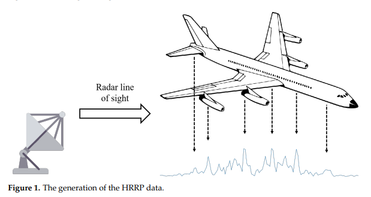
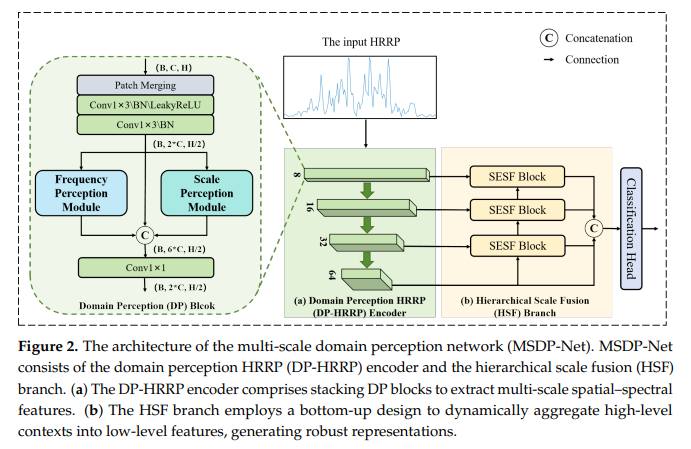
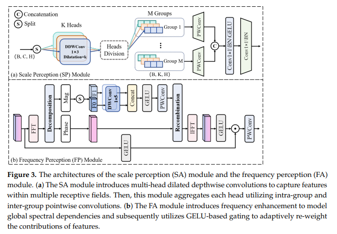
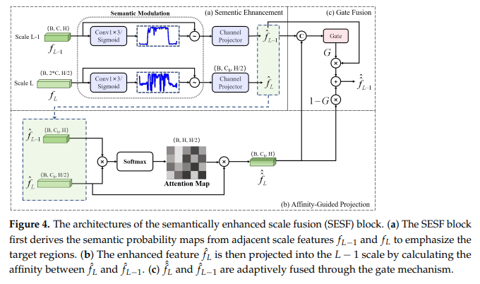
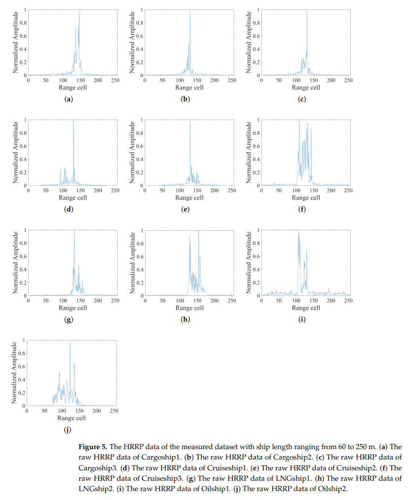
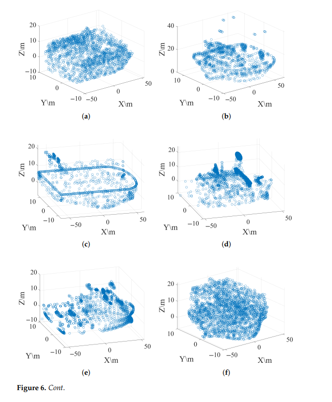
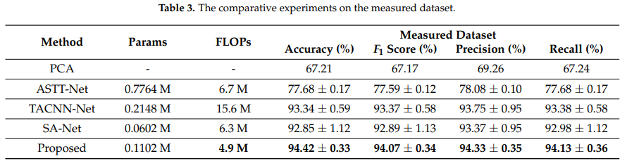
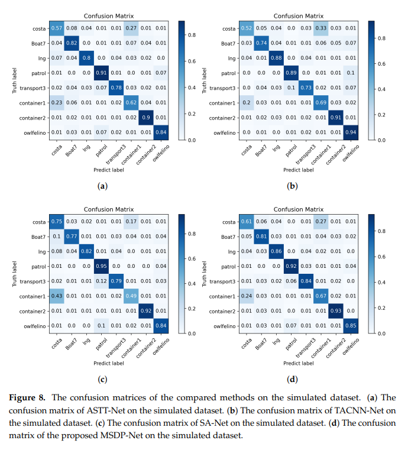
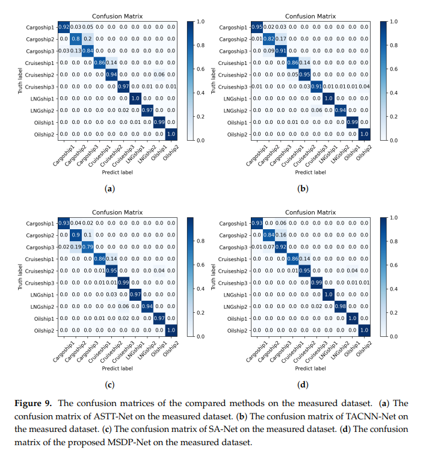
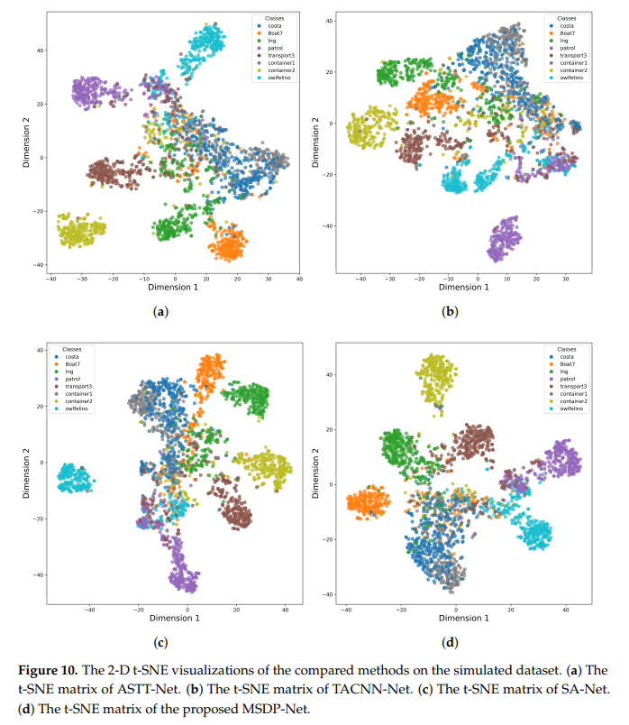

# New breakthrough in radar target recognition! MSDP-Net: lightweight multi-scale domain perception network, making HRRP identification more precise. [Attached Python code]

Radar Target Recognition Breakthrough! MSDP-Net: Lightweight Multi-Scale Domain Perception Network, Enhancing the Accuracy of HRRP Identification
In the field of real-time, all-weather automatic target recognition (RATR) for radars, High-Resolution Range Profile (HRRP) has become a core technology for non-cooperative target identification due to its computational efficiency and real-time nature. However, in complex scenarios, how to simultaneously capture the multi-scale spatial dependencies of HRRP signals and the global spectral relationships remains an industry challenge.
Recently, a research team from Harbin Institute of Technology proposed MSDP-Net—a lightweight multi-scale domain perception network aimed at HRRP target recognition. By combining air-frequency joint feature learning with hierarchical scale fusion, it achieves SOTA performance on both simulated and real-world datasets, providing a new solution for precise radar target identification.
1. HRRP Target Recognition: The "Core Necessity" of Radar Perception
Although Inverse Synthetic Aperture Radar (ISAR) can achieve high-resolution imaging, it requires high stability of target motion and long data collection periods, making it difficult to meet the real-time perception needs in dynamic scenarios.
High-Resolution Range Profile (HRRP) represents the one-dimensional backward scattering distribution of targets in the radar line of sight direction. It can be obtained with a single pulse wideband radar, requiring low relative motion and minimal computational overhead, making it an optimal choice for military sea defense, civil shipping, and air traffic control scenarios.
Traditional HRRP recognition relies on manually designed features and classical classifiers, which not only require deep domain knowledge but also have issues such as complex computation and poor robustness. Methods based on deep learning can automatically extract features, but most focus on unidomain features, failing to explore cross-scale and cross-domain interaction information, leading to significantly reduced recognition accuracy under low signal-to-noise ratio and attitude changes scenarios.
To address this issue, the research team constructed the multi-scale domain perception network MSDP-Net, achieving joint learning of air-frequency dual-domain features and cross-scale adaptive fusion, breaking through the performance bottleneck of traditional methods.
II. MSDP-Net Core Architecture: Spatio-Frequency Collaboration + Hierarchical Fusion, Driven by Dual Engines for Precision Recognition
MSDP-Net adopts a dual branch structure, consisting of the Domain-Aware HRRP Encoder (DP-HRRP Encoder) and the Hierarchical Scaling Fusion Branch (HSF Branch). This design balances lightweightness with high precision, achieving a balance between light weight and high accuracy.
1. DP-HRRP Encoder: Spatio-Frequency Sensing, Capturing Global + Local Features
The DP-HRRP Encoder serves as the "Core for Feature Extraction" in the network. It employs a scale-aware module (SP) and a frequency-aware module (FP) through dual paths to simultaneously mine the spatial structure and spectral characteristics of HRRP.
(1) Scale-Aware Module (SP): Multi-scale Sensing to Capture Spatial Dependencies
The SP module introduces multi-head expansion deep convolution (DDWConv), segmenting feature maps into K parallel heads along the channel dimension. Each head utilizes a different expansion rate to cover multiple scale sensitivities, accurately capturing the scattering structure at different granularities of targets.
Multi-Head Convolution: Covering Small-Scale Details and Large-Scale Global Spatial Relations
Group Aggregation: Enhancing Feature Diversity and Avoiding Information Redundancy
Pointwise Convolution: Merging Group and Intergroup Information, Strengthening Feature Expression
(2) Frequency-Aware Module (FP): Frequency Enhancement, Highlighting Key Spectral Components
The FP module focuses on the global spectral characteristics of HRRP. Through frequency domain transformation, it enhances key scattering components:
1. Fast Fourier Transform (FFT) maps features to the frequency domain, separating amplitude and phase
2. Multi-scale deep convolution enhances the amplitude component, highlighting the target scattering center spectral characteristics
3. Inverse Fourier Transform (IFFT) converts back to the spatial domain, combined with GELU gate control mechanisms, adaptively balancing original features with spectrally enhanced features
After spatio-frequency dual paths are fused, the encoder can preserve fine spatial details while modeling global spectral dependencies, providing high-quality multiscale features for subsequent fusion.
2. HSF branch: From bottom to top hierarchical fusion, aggregating cross-scale semantic information is not enough; how to efficiently integrate information from different scales is key to improving recognition accuracy. The HSF branch adopts a stacking structure from the bottom up, and achieves progressive information aggregation from fine-grained to coarse scales through Semantic Enhanced Scale Fusion Block (SESF).
SESF block's core logic:
1  
Semantic modulation: Generate semantic probability maps, reinforcing key distance units within various scales.
2  
Cross-scale Attention Projection: Mapping high-level semantic features to low-level spaces, guiding the optimization of detail features.
3  
Adaptive Gating Fusion: Dynamically assigning weights for high-level semantics and low-level details to generate a unified robust feature representation.
This fusion strategy allows the network to simultaneously preserve fine-grained structural details and high-level semantic context, effectively addressing the posture sensitivity and scattering complexity of HRRP.
3. Classification and Loss Design: Lightweight output, efficient convergence network ultimately compresses multi-scale fused features through adaptive average pooling, and classifies the results after concatenation through a linear classification head; employs cross-entropy loss for supervision training to ensure rapid convergence of the model and clear classification boundaries.
III. Experimental Verification: Double Data Sets Top the Chart, Achieving Both Accuracy and Efficiency. The research team conducted comprehensive experiments on both simulated dataset and real-measured maritime target datasets to verify the performance advantages of MSDP-Net. The comparison methods included mainstream HRRP recognition models such as ASTT-Net, TACNN-Net, SA-Net, etc.
1. Experimental setup dataset: Simulated dataset contains 8 classes of ships, real-measured dataset contains 10 classes of ships (60–250m), with 2000 samples per class, divided into training/validation/test sets at a ratio of 7:1.5:1.5.
Hardware environment: Intel Xeon CPU + NVIDIA RTX 1660s GPU
Training configuration: AdamW optimizer, batch size 64, 100 iterations, with 10dB Gaussian white noise to simulate real interference.
2. Core experimental results (1) Accuracy: Both datasets achieve optimal performance.
Simulation dataset: Accuracy 80.75%, F1 score 80.74%, surpassing the comparison methods by 1.23%–2.67%.
Real-measurement dataset: Accuracy 94.42%, F1 score 94.07%, surpassing the comparison methods by 1.08%–2.00%.
(2) Computation efficiency: Lightweight design, adaptable for edge deployment.
Parameter scale: 0.1102 M, only 14% of ASTT-Net and 51% of TACNN-Net.
Computational load: 4.9 M FLOPs, reduced by 22% compared to SA-Net and 69% compared to TACNN-Net.
(3) Visualization verification: T-SNE visualization shows clearer feature clustering in MSDP-Net. The extracted features have clearer boundary lines and more compact clusters, especially for misclassified categories such as cargo ships and cruise ships in the real-measurement dataset, where the separation effect is significantly superior to other methods.
Ablative experiments: Each module is essential for research team to verify effectiveness through removing key modules:
Removing DP block: Accuracy drops by 12.74%, core is the joint extraction of frequency and sparsity.
Removing SP module: Accuracy drops by 2.41%, multi-scale spatial features are crucial.
Removing FP module: Accuracy drops by 0.45%, spectral enhancement improves robustness.
Removing HSF branch: Accuracy drops by 0.76%, cross-scale fusion strengthens feature representation.
Experiments prove that the combination of dual-domain sparsity + hierarchical scale fusion is key to the performance lead of MSDP-Net.
IV. Technological Value and Application Scenarios: Empowering Radar Real-Time Perception of MSDP-Net as a lightweight HRRP target recognition network, it possesses three major advantages: high accuracy, low computational requirements, and strong robustness. It can be widely applied in:
1  
Maritime Security: Ship Type Identification, Illegal Intrusion Monitoring
2  
Air Traffic Control: Classification of UAVs and Aircraft Objects
3  
Battlefield Perception: Real-time Non-Cooperative Target Identification, Low-Power Device Deployment
4  
Intelligent Transportation: Radar Target Detection and Classification, Aiding Autonomous Driving Environmental Perception
Compared to traditional methods, MSDP-Net does not require manual feature engineering and can adaptively learn the spatial-frequency features of HRRP. It maintains stable recognition in complex scenarios such as low signal-to-noise ratio and attitude changes, solving the longstanding issue of balancing robustness and real-time performance in the industry.
V. Summary and Outlook
In the future, the research team will further integrate multimodal information such as infrared and multi-view, optimize the model's recognition ability for small and similar targets, and promote the development of radar automatic target recognition towards multimodality, lightweight, and high accuracy.
The introduction of MSDP-Net not only provides a new technical path for HRRP target identification but also lays the foundation for the engineering implementation of real-time radar perception systems, aiding in the intelligent upgrade of defense in the fields of maritime security, aviation, and security.

## Images

<!-- PAYMENT_BLOCK -->

## Get this dataset

- Payment link (Stripe): [Buy now](https://buy.stripe.com/3cs8yP7sY87d0vu9AB)
- Payment QR code: 

<!-- /PAYMENT_BLOCK -->
